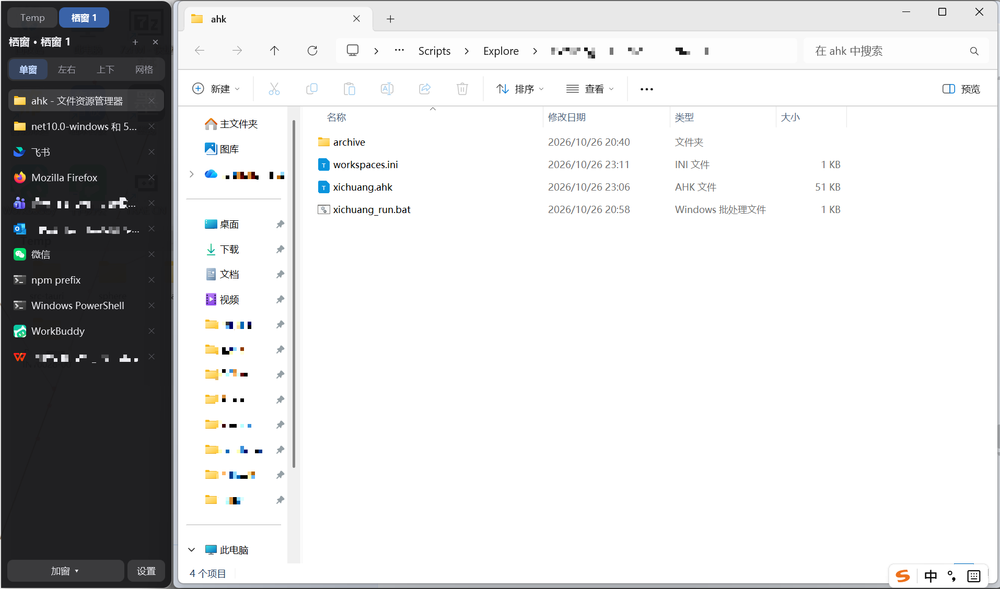

# 方寸 (Fangcun) · 栖窗

> 方寸之间，图标各安其位；一栏之内，窗口各归其位。

把桌面上的两类东西分别收起来：**方寸**收图标，**栖窗**收窗口。

同一个进程、同一个 exe。方寸保持原样，栖窗作为模块挂在它下面 —— 托盘点一下就能展开一条贴边的侧栏，把散落的窗口拢进工作区，悬停即切、一键分屏。



## 这是什么

Windows 桌面上其实有两种"乱"：

| 乱在 | 谁管 | 管理对象 |
| --- | --- | --- |
| 桌面图标堆成一片 | 方寸 | 静态的图标、文件夹、快捷方式 |
| 任务栏挤满、窗口互相遮挡 | 栖窗 | 动态的应用窗口 |

两者互不干扰：方寸在桌面层（Progman / SysListView32）摆图标，栖窗只对顶层窗口做移动与缩放，不抢占、不嵌入。

## 功能特性

### 方寸：桌面图标围栏

-   把桌面图标分组到围栏里，围栏可拖动、可缩放、可改透明度
-   围栏底色可取自壁纸（壁纸染色），或自定义纯色
-   图标溢出策略：滚动 或 省略
-   围栏层级：贴底（在图标之下）、置顶、常规窗口
-   监视文件夹：围栏可绑定一个文件夹，内容变化时自动同步
-   多显示器：每个围栏可指定所属显示器，配置随显示器保存
-   开机自启、配置持久化、全局异常兜底

### 栖窗：窗口归集

-   **侧栏归集**：贴屏幕左、右、上、下任一边缘，把归集的窗口按布局排到剩余区域
-   **悬停即切**：鼠标停在清单项上就把该窗口提到前台（可改为单击触发，延迟可调）
-   **四种分屏**：单窗铺满、左右分列、上下分行、四宫格
-   **多工作区**：侧栏顶端是 tab 条，可新建、切换、右键重命名或删除；不同栖窗互不抢窗口
-   **一个栖窗 = 一组窗口**：切 tab 时上一组的窗口整体最小化、新一组整体登场；侧栏收起时其窗口一起收起，恢复时一起回来
-   **加窗**：底部「加窗 ▾」列出所有可加入的窗口，点选或拖入即可；也有「全部加入」
-   **已关闭也能留住**：窗口被关掉后该行变灰并标「已关闭」，点一下（或点行尾 ↻）重新打开，重开后回填同一行
-   **自动记住**：名字、布局、成员窗口身份随时落盘；下次启动按身份匹配恢复（可选开关）
-   **停靠可选**：侧栏可放主屏或副屏，可停四条边的任意一条，改完即时生效
-   **从围栏发射**：围栏右键「栖窗归集」会用默认应用打开该围栏里的文件/文件夹，并把这次产生的窗口拢进以围栏命名的栖窗

## 系统要求

-   Windows 10 / 11，x64
-   .NET 10 SDK（仅构建需要）
-   运行时依赖：自包含版无；框架依赖版需 .NET 10 桌面运行时（x64）
-   Visual Studio 2022（可选，命令行构建亦可）

## 构建

开发构建：

```bat
dotnet build Fangcun.sln -c Release
```

产物在 `src/Fangcun/bin/Release/net10.0-windows/Fangcun.exe`（栖窗模块以 `Fangcun.Xichuang.dll` 形式一并输出）。

发布：一条命令产出两个版本，也可分别构建。

```bat
tools\publish-release.bat          :: 两个都构建
tools\publish-release.bat full     :: 只要自包含版
tools\publish-release.bat lite     :: 只要框架依赖版
```

| 产物 | 体积 | 目标机要求 |
| --- | --- | --- |
| `dist\Fangcun-win-x64-full.exe` | 约 78 MB | 无，双击即跑 |
| `dist\Fangcun-win-x64-lite.exe` | 约 0.3 MB | 需装 [.NET 10 桌面运行时](https://dotnet.microsoft.com/download/dotnet/10.0)（Desktop Runtime，x64） |

两个都是**单个 exe**，给谁发哪个看对方机器：

-   不确定、或对方是普通用户 → 发 **full**，最省事；
-   对方开发机/已装 .NET 10 桌面运行时 → 发 **lite**，邮件附件都塞得下。

手动命令（等价于脚本内部做的事）：

```bat
:: full —— 自包含
dotnet publish src\Fangcun\Fangcun.csproj -c Release -r win-x64 --self-contained true ^
  -p:PublishSingleFile=true ^
  -p:IncludeNativeLibrariesForSelfExtract=true ^
  -p:EnableCompressionInSingleFile=true ^
  -p:PublishReadyToRun=true ^
  -p:DebugType=none -o dist\_full

:: lite —— 框架依赖
dotnet publish src\Fangcun\Fangcun.csproj -c Release -r win-x64 --self-contained false ^
  -p:PublishSingleFile=true ^
  -p:DebugType=none -o dist\_lite
```

| 参数 | 作用 | 适用 |
| --- | --- | --- |
| `--self-contained` | `true` 自带运行时；`false` 依赖目标机已装 | 两者 |
| `-p:PublishSingleFile=true` | 打成单个 exe | 两者 |
| `-p:IncludeNativeLibrariesForSelfExtract=true` | 把 WPF 的原生库（`wpfgfx_cor3.dll` 等）也塞进 exe，否则会散落在旁边 | 仅 full |
| `-p:EnableCompressionInSingleFile=true` | 压缩，体积约减一半 | **仅 full**（框架依赖版带此参数会报 `NETSDK1176`） |
| `-p:PublishReadyToRun=true` | 预编译，启动更快，体积略增 | 仅 full |

⚠️ **不要加 `-p:PublishTrimmed=true`**：WPF 依赖 XAML 反射，裁剪后会在运行时报找不到类型。

## 使用说明

### 托盘菜单

| 菜单项 | 作用 |
| --- | --- |
| 开机自启 | 登录时自动启动方寸 |
| 新建围栏 | 在桌面新建一个空围栏 |
| 隐藏所有围栏 | 一键收起或显示全部围栏（文字随状态变化） |
| 栖窗（集） | 把当前所有未归入其它栖窗的窗口收进一个新工作区并显示侧栏 |
| 栖窗（复） | 按上次保存的配置恢复栖窗并重新显示（已存在的同名栖窗不覆盖） |
| 栖窗设置 | 打开栖窗设置窗 |
| 退出方寸 | 保存并退出 |

### 侧栏操作

| 操作 | 效果 |
| --- | --- |
| 鼠标悬停清单项 | 按悬停延迟把该窗口提到前台 |
| 单击清单项 | 触发模式设为「单击」时聚焦该窗口 |
| 行尾 ✕ | 把该窗口移出当前栖窗（窗口本身不关闭，恢复正常浮动） |
| 行尾 ↻ / 点灰行 | 重新打开已关闭的窗口 |
| 底部「布局」分段按钮 | 切换单窗、左右、上下、四宫格 |
| 底部「加窗 ▾」 | 列出可加入的窗口，点选或拖入；顶部有「全部加入」 |
| 底部「设置」 | 打开设置窗 |
| tab 单击 | 切换栖窗（上一组的窗口收起，这一组登场） |
| tab 上的 ＋ | 新建一个空栖窗 |
| tab 右键 | 重命名 / 删除此栖窗 |
| 标题栏 — | 收起侧栏（其窗口一起最小化） |

### 围栏右键

| 菜单项 | 作用 |
| --- | --- |
| 栖窗归集 | 打开该围栏内的文件/文件夹，并把产生的窗口拢进同名栖窗 |
| 重命名 | 修改围栏标题 |
| 预设主题 / 显示模式 / 溢出模式 / 层叠模式 / 同步模式 | 方寸的围栏外观与行为设置 |
| 删除围栏 / 新建围栏 | 删除当前围栏 / 桌面新建围栏 |
| 打开 / 打开所在位置 / 从围栏移除 | 对围栏内单个图标的操作 |

### 设置项

| 设置 | 说明 |
| --- | --- |
| 触发方式 | 悬停 或 单击 |
| 悬停延迟 | 悬停多久才触发聚焦 |
| 最小化模式 | 聚焦时把上一个窗口最小化（只留一个） |
| 侧栏宽度 | 默认 220，在设置窗中修改 |
| 停靠边 | 左 / 右 / 上 / 下 |
| 所在显示器 | 主屏或任一扩展屏 |
| 启动时恢复上次的栖窗 | 打开则启动后按上次快照恢复 |

## 设计取舍

-   **移动/缩放真实窗口，不做 SetParent 嵌入。** 嵌入（把别人的窗口塞进自己容器）在 IME、重绘、DWM 圆角、焦点上容易和目标程序打架；移动缩放则每个程序仍是它自己的窗口，覆盖 UAC、UWP、自绘标题栏程序都稳。
-   **只对活动栖窗排布。** 后台栖窗只记账不动窗口，切换时才登场，避免多组窗口在屏幕上互相压叠。
-   **不抢 z 序。** 归集时清除遗留的置顶属性，新打开的程序永远能正常盖在上面。
-   **同一进程，异常隔离。** 栖窗的异常由方寸的全局异常兜底捕获并提示，不静默崩溃。

## 技术栈

-   C# / .NET 10（net10.0-windows）
-   WPF（围栏、侧栏、设置窗）
-   Windows Forms（仅托盘图标与上下文菜单）
-   Win32 P/Invoke（窗口枚举、移动缩放、DPI、多显示器、前台激活、图标提取）
-   Per-Monitor V2 DPI 感知

## 目录结构

```text
fangcun/
├── Fangcun.sln                 解决方案（方寸 + 栖窗）
├── README.md
├── CHANGELOG.md
├── LICENSE
├── docs/
│   └── demo-sidebar.png        栖窗侧栏演示图
├── tools/
│   ├── publish-release.bat     一键发布 full/lite 两个单文件 exe 到 dist/
│   └── regen_icon.py           重新生成应用图标
└── src/
    ├── Fangcun/                方寸：桌面图标围栏（程序入口，输出 Fangcun.exe）
    └── Fangcun.Xichuang/       栖窗模块：窗口归集（类库，输出 Fangcun.Xichuang.dll）
        ├── Native/             Win32 声明、窗口枚举
        ├── UI/                 侧栏、设置窗
        ├── Launcher.cs         统一入口（托盘/围栏调用）
        ├── WindowManager.cs    窗口集合、布局重排、聚焦
        ├── WindowSlot.cs       槽位模型（活窗口 / 已关闭 / 打开中）
        ├── LayoutEngine.cs     四种布局的矩形计算与落位
        └── XichuangConfig.cs   配置与持久化
```

## 已知限制

-   目标程序以管理员权限运行、而本程序以普通权限运行时，受 UIPI 限制无法把窗口提到前台（会退化为让窗口浮到最前，但不夺焦点）。解决办法是以相同权限运行。
-   手动「加窗」进来的窗口，重开只能精确到程序，不保证回到原来那份文档 —— Windows 没有通用接口反查"某窗口是哪个文件打开的"。从围栏归集的窗口记录了源路径，重开是精确的。
-   单个 exe 意味着方寸与栖窗同生共死；栖窗的异常已由全局兜底接管，不会拖垮围栏。

## 许可证

[MIT](LICENSE) © 2026 highwindmx

Powered by WorkBuddy
